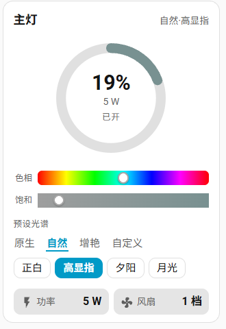
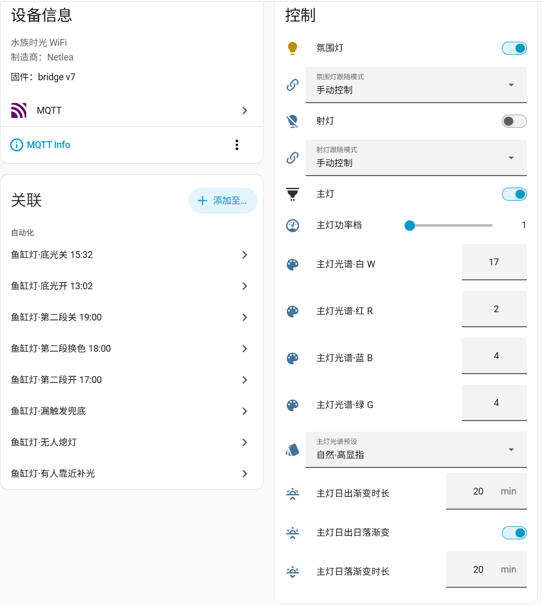

# Netlea_bridge

> **⚠️ 开发声明 / 免责声明（部署前必读）**
>
> 本项目是个人开发的**非官方**工具，与尼特利（Netlea）**没有任何关联**，未获厂商授权或技术支持。
> 使用它可能影响 **灯具硬件**（过载、过热、光衰、驱动损坏）、**厂商云服务与账号**（限流、封禁、失去保修）。
> 一切后果由**使用者自行承担**，作者与贡献者**不承担任何责任**，项目按「现状（AS IS）」提供。
> 网页向导中必须勾选同意才会启动桥接；完整条款见 **[DISCLAIMER.md](DISCLAIMER.md)**（程序内同文 `/disclaimer.html`）。
> **不同意请勿部署。**

把「尼特利 水族时光 500 Ultra 顶配版」WiFi 水草灯接进 Home Assistant 的桥接程序 + 自研 Lovelace 卡片。

设备端只用厂商云（灯不开放本地协议），桥接常驻在 NAS 上，通过厂商 WebSocket 收发光谱帧，再以 MQTT Discovery 暴露成 HA 实体。

## 适用型号

整套参数（四通道顺序、原厂 12 组光谱的全档位表、风扇 PWM 映射）都是按下面这一款实测逆向出来的：

| 项 | 值 |
|---|---|
| 零售型号 | **SG-500U-YD**（「500 Ultra 顶配版」，WiFi + 蓝牙双模） |
| 固件机型串 | `SG-500u-YDw11`（APP「设备信息」里的机型名，桥接靠它匹配档位表） |
| 总功率 | 60W = 主灯 **50W** + 射灯 **7W** + 氛围灯 **3W** |
| 电源 | DC 36V / 1.8A，支架安装，139×139×57mm |
| 控制方式 | APP + 触控 + 语音，三路灯光（主灯/射灯/氛围灯）独立可调 |
| 光谱通道 | R / W(白) / G / B 四通道 0–110，风扇 0–10 档（内部 PWM 100–230） |

同一系列的其他型号（500 Pro、500S、SG-500u 的其他后缀等）**未经验证**：档位表、通道顺序、风扇映射都可能不同，直接套用有烤灯风险，请先自己核对 `data/model_spectrums.json` 与真机回帧。

装好之后，HA 里长这样：

<p align="center">
  
  
</p>

左边是自研的 `netlea-light-card`：圆环点/拖调亮度（19% = 5W），色相与饱和度滑条直接控制 R/W/G/B 四通道，预设按「原生 / 自然 / 增艳 / 自定义」分组，底部实时显示功率和风扇档位（风扇只读，跟随功率自动变速）。

右边是桥接暴露出来的实体：主灯/射灯/氛围灯各自开关与跟随模式，主灯功率档、四通道光谱、预设选择、日出/日落渐变时长——和官方 APP 的操作维度一一对应。

## 目录

```
bridge.py                  桥接主程序（v15：带网页配置向导 + 控制页）
www/index.html             8099 端口的网页（1 手机号验证码登录 → 2 设备ID → 3 MQTT → 直接控灯）
netlea-light-card.js       自研 Lovelace 卡（圆环开关 + 色谱 + 预设分组 + 功率/风扇）
legacy/                    已废弃的第一版色谱卡（仅供对照，不再注册到 HA）
docs/                      设备接入全过程记录（含帧格式、参数表、踩坑）
data/
  model_spectrums.json     原厂 12 预设全档位表（R,G,W,B,F,P），从官方 XAPK lamp.txt 解析
  levels_block.txt         由 model_spectrums 生成的 LEVELS 常量代码块
  cap_gear_log.jsonl       真机采集原始回帧日志
tools/                     采集与生成脚本（详见「工具」一节）
dashboard/
  lovelace_鱼缸_备份_20261125.json   改动前的仪表盘配置备份
```

## 架构

```
灯 (<LAMP-IP>)
  ↕ 厂商云 WebSocket  ws://v3grpc.netlea.com:8088/websocket   (header token)
NAS 容器 netlea-bridge  (--network host, python:3.11-slim)
  ├─ 解析 cmd20/cmd26/27... 回帧 → 本地状态
  ├─ MQTT publish → <MQTT-IP>:1883  (homeassistant discovery prefix)
  └─ 8099 端口的静态服务 → 给 HA 前端下发 netlea-light-card.js（带 CORS 头）
HA (<HA-IP>:8123)
  └─ MQTT 集成自动发现 25 个实体 + custom:netlea-light-card 卡片
```

约束与坑（务必先读 `docs/尼特利水族时光接入HA-2026-11-23.md` 第十二节）：

- **不要再新开一条同 token 的 WS 连接**，厂商云一个账号只允许一条，会把常驻桥踢下线。
- 任何「查状态」都不要用 `cmd5`（那是灯具初始化，会重载设备存储状态）；用 `cmd21`。
- `cmd16` 只改实时输出、不落盘；`grade`（档位）和 `modeId` 必须再走 `cmd26` 才持久。
- 四通道字节顺序是 **R, W(白), G, B**（不是 R,G,W,B）。
- 拖色谱/连续调色要节流写 `cmd26`，否则设备被刷爆。

## 实体（HA）

| 类别 | entity_id | 说明 |
|---|---|---|
| 主灯光源 | `light.netlea_tank_light` | `supported_color_modes: rgb`，给 `rgb_color` 即按四通道换算下发 |
| 光谱通道 | `number.netlea_master_r/g/w/b` | 0–110，动任一通道即切「自定义色」 |
| 风扇档位 | `sensor.ni_te_li_shui_zu_shi_guang_zhu_deng_feng_shan_dang_wei` | **只读**。转速由功率档/预设推导，不开放手动调低（防低风扇 + 高功率烧灯） |
| 功率档 | `number.netlea_master_grade` | 1–各预设档数，换档整套光谱下发 |
| 预设 | `select.netlea_master_preset` | 原生 4 / 自然 4 / 增艳 4 / 自定义，共 13 项 |
| 功率读数 | `sensor.ni_te_li_shui_zu_shi_guang_zhu_deng_gong_lu` | 按预设+档位查原厂表得出 W |
| 射灯 / 氛围灯 | `light.netlea_tank_spot` / `light.netlea_tank_atmo` | 各自的开关、亮度、跟随模式 |

## 安装（网页版）

### 前置条件

- 一台常开的机器（NAS / 小主机 / 树莓派都行），装好 Docker + Docker Compose
- 家里有一个 MQTT broker（HA 的 Mosquitto 插件自带），知道地址、端口、账号密码
- Home Assistant 已装 **MQTT 集成**并连到同一个 broker（否则桥接发布了实体，HA 也看不见）
- 尼特利 APP 里已绑定自己的灯，且账号能正常登录

### 第 0 步：先读声明并同意

先读 [DISCLAIMER.md](DISCLAIMER.md)。继续部署 = 你已接受「硬件、厂商服务与账号受影响的风险自负，作者不承担责任」。等你走到网页向导时，**必须勾选同意**才能启用桥接；不勾选会直接被拒（不会写配置、不会连灯）。

### 三步

```bash
git clone https://github.com/frankluise5220/Netlea_bridge.git
cd Netlea_bridge
docker compose up -d
```

（不用 compose 也可以：`docker build -t netlea-bridge . && docker run -d --name netlea-bridge --network host -v ./data:/data -e NETLEA_CONFIG=/data/config.json netlea-bridge`）

浏览器打开 `http://<主机IP>:8099/`，配置页最上方是声明卡片，勾选「我已阅读并同意免责声明」后再填三步：

1. **登录**：手机号 → 「获取验证码」→ 填短信码 → 「登录并获取授权」（拿到 token）。
2. **灯具设备 ID**：灯的 MAC 去掉冒号转大写（APP 设备详情能看，或路由器 DHCP 列表按 MAC 找）。
3. **MQTT**：broker 地址/端口/账号/密码，前缀保持 `homeassistant`。

点「保存并启动桥接」→ 状态条变成「配置完整 / 运行中 / 设备在线」，HA 里会自动出现 `light.netlea_tank_light` 等实体。这时就可以在 HA 或网页「控制」页开灯、换预设、调档位。

### 目录与端口说明

| 项 | 说明 |
|---|---|
| `8099/tcp` | 配置向导 + 控制页 + 厂商云 API 代理 + 卡片 JS |
| `/data` | 只放 `config.json`（挂 volume，重启不丢配置） |
| `NETLEA_CONFIG` | 配置文件路径，容器内默认 `/data/config.json` |
| `NETLEA_WEB_PORT` | 网页端口，默认 8099 |
| `--network host` | 让桥接能直接访问局域网里的灯和 broker；用 bridge 网络也行，但要自己映射 8099 |

装完之后 HA 仪表盘要加卡片的话，见下面「卡片」一节（资源 URL 指向 `http://<主机IP>:8099/netlea-light-card.js`）。

向导三步（都是服务端代理，浏览器不直连厂商云，绕开 CORS）：

1. **登录**：`GET /V3/Api/captchaMsg?captchaMsgFlag=3&phonenumber=<手机号>` 拿 `uuid`，再 `POST /V3/Api/appuser/loginBycode {"username","uuid","code"}` 换 `token`（鉴权头是裸 `Authorization: <token>`，无 `Bearer`）。
2. **设备 ID**：灯具 MAC 去掉冒号转大写（`a0:85:e3:4e:91:58` → `<设备ID>`）。
3. **MQTT**：地址/端口/账号/密码/前缀。

点「保存并启动桥接」后，配置写入 `/app/config.json`，桥接**热启动**（不用重启容器）。

网页 API（同端口 8099）：

| 路径 | 说明 |
|---|---|
| `GET /api/status` | 配置/运行/在线状态 + 当前预设、档位、风扇、四通道 |
| `POST /api/sms` `{phone}` | 发短信验证码，返回 `uuid` |
| `POST /api/login` `{phone,uuid,code}` | 换 `token` |
| `POST /api/verify` `{token}` | 校验 token 是否有效 |
| `POST /api/save` | 写配置并热启动（token/设备ID/MQTT） |
| `POST /api/cmd` `{action:"on"|"off"|"preset"|"grade"|"fan"|"channel", ...}` | 直接控灯 |
| `POST /api/restart` | 重启桥接 |

> 8099 无鉴权，只适合放在局域网/内网。要暴露到公网请自己在前面加反代 + Basic Auth。

## 部署

```bash
# 把 <NAS-USER> / <NAS-IP> / <key> 换成你自己的 NAS 账号、内网地址和私钥
scp -O -i <key> bridge.py        <NAS-USER>@<NAS-IP>:/tmp/bridge.py
scp -O -i <key> netlea-light-card.js <NAS-USER>@<NAS-IP>:/tmp/netlea-light-card.js

ssh -i <key> <NAS-USER>@<NAS-IP> \
  'sudo cp /tmp/bridge.py /volume1/docker/netlea-bridge/bridge.py; \
   sudo cp /tmp/netlea-light-card.js /volume1/docker/netlea-bridge/www/; \
   sudo /usr/local/bin/docker restart netlea-bridge'
```

注意 `scp` 必须带 `-O`（老 scp 协议），否则 synology 侧报 `dest open: No such file or directory`。

### 卡片资源（类型 `module`）——两种放法，选一种

**注意：如果 HA 是用 https 打开的，卡片资源也必须是 https，否则一定显示「配置错误」。**

https 页面加载 `http://` 脚本属于 mixed content，浏览器和 iOS/Android 的 HA APP（WebView）都会直接拒绝，`custom:netlea-light-card` 这个元素就不会被注册，仪表盘上只剩一块粉色的「配置错误」。很多人 HA 局域网用 http、外网走反代 https，桌面浏览器正常、手机 APP 报错，就是这个原因。

| 放法 | 资源 URL | 适用 |
|---|---|---|
| A. 桥接自带静态服务 | `http://<主机IP>:8099/netlea-light-card.js` | HA 只用 **http** 访问（纯内网） |
| B. HA 本地 www 目录 | `/local/netlea-light-card.js` | 推荐，与 HA 同源，http / https 都能用 |
| C. 公网 CDN | `https://cdn.jsdelivr.net/gh/<你的用户名>/Netlea_bridge@<commit>/netlea-light-card.js` | HA 走 https 又不想动 HA 文件系统时 |

B 的具体做法：把 `netlea-light-card.js` 拷到 HA 的 `/config/www/` 下（Samba、SSH 或 File editor 插件都行），然后在「设置 → 仪表盘 → 资源」加一条 `/local/netlea-light-card.js`，类型选 **JavaScript 模块**。这样不跨源、不受 http/https 影响，也不用给 8099 端口做任何暴露。

A 由 `bridge.py` 的 `start_web()` 提供，**必须返回 `Access-Control-Allow-Origin: *`**，否则 HA(8123) 与 8099 跨源，ES module 会被浏览器拒绝加载。

C 用的是公开仓库的 jsDelivr 地址，自带 CORS 和正确 MIME；`@<commit>` 换成你仓库的提交号（用提交号而不是 `@main`，jsDelivr 会长期缓存分支内容，改卡片后不换 URL 会看不到更新）。代价是依赖第三方 CDN。

## 卡片

`netlea-light-card.js` 一个组件内包含：

- 圆环：点圆心开关；沿圆环拖动调明度（2%–100%）
- 色相 / 饱和度两条滑条
- 预设光谱：上排分组（原生/自然/增艳/自定义），下排该组具体预设，点即生效
- 功率 / 风扇实时读数（风扇只读，跟随功率档）
- 走 `light.turn_on { rgb_color }` / `select.select_option`，不额外引入中间实体

仪表盘里建议的布局参数（sections 视图）：

```yaml
grid_options:
  columns: 6      # 与同 section 内 tile 卡等宽；"full" 会占满整个 section
  rows: 6         # 必须写实际行数，写 auto 会被当成 1 行，右侧就排不下多张卡
```

## 工具

| 脚本 | 用途 |
|---|---|
| `tools/cap_gear.py` | 通过 MQTT debug 主题（`netlea/tank_light/debug/send` / `raw`）订阅并采集回帧，不新开 WS |
| `tools/analyze_cap.py` | 解析采集日志，统计档位/通道/风扇对应关系 |
| `tools/extract_table.py` | 从官方 XAPK `lamp.txt` 定位本机型 `config.zhudengConfig` 节点 |
| `tools/dump_model_table.py` | 花括号配平解析出 12 预设全档位 → `data/model_spectrums.json` |
| `tools/gen_levels.py` | 生成 `bridge.py` 里 `LEVELS` 常量代码块 |
| `tools/patch_levels.py` | 用 `ast.parse` 校验后写回 `bridge.py`（非手抄） |
| `tools/peek_line.py` | 按行号看 `lamp.txt` 片段 |

MQTT debug 主题的常用帧：

- `5A070115000077` → `cmd21`（安全查状态，回 `cmd20`）
- `5A08011B0000007E` → `cmd27[0]`（读主灯配置）

## 版本

- `bridge.py` v15：抽出配置加载（缺失/不完整时进入待配置态，不再启动即崩）；`Bridge` 支持 `stop()` 与热重启；8099 由静态服务升级为「配置向导 + 控制页 + 厂商云 API 代理」
- `bridge.py` v14：`set_preset` / `set_grade` / `set_channel` / `set_master` 补 `pub_all()`，切预设后功率、风扇、预设实体立即刷新；静态服务加 CORS 头
- 卡片：由 `div` 改为原生 `ha-card` 承载外框；`box-sizing: border-box` 修内容溢出；自适应窄宽（不换行 + 横向滚动）
